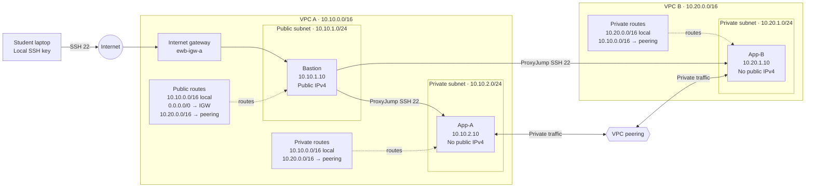

# Lab architecture

The bastion has a public address only for laptop administration. App-A and App-B use private IPv4 addresses. Their VPC CIDRs do not overlap, and routes must exist in both directions for peered traffic. VPC B has no internet gateway and cannot use VPC A's internet gateway through peering. Project-specific security groups restrict SSH and ICMP Echo requests to the lab sources described in the [runbook](runbook.md).

